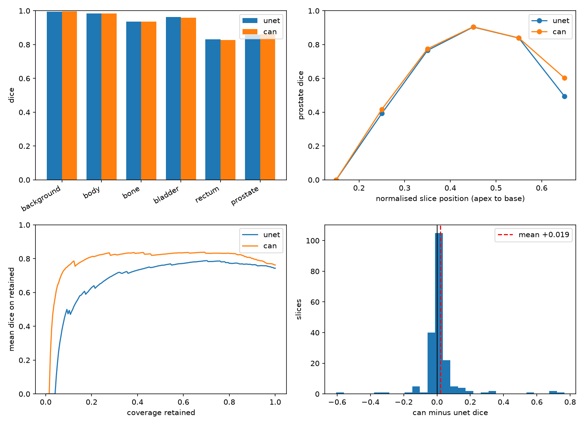
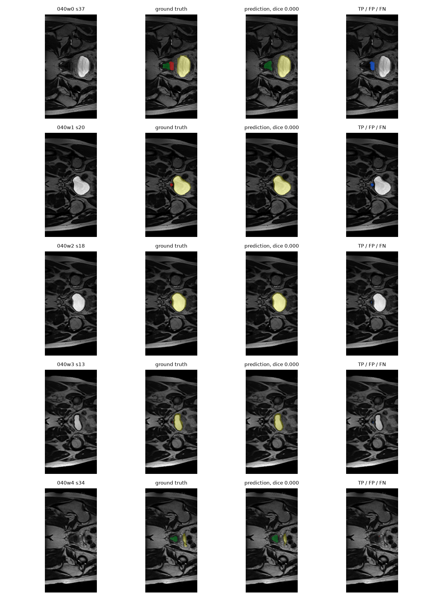

# 2D Prostate MRI Segmentation: U-Net vs Dilated Context Aggregation

COMP3710/COMP7710 final project. This repository implements a 2D U-Net baseline and a
U-Net with a dilated context aggregation block for multi-class segmentation of pelvic
MRI slices from the HipMRI study. The primary target is the prostate; bladder, rectum,
bone and body outline are segmented as auxiliary classes.



## 1. Problem

Radiotherapy planning for prostate cancer requires a clinician to delineate the prostate
clinical target volume and the surrounding organs at risk (bladder, rectum, femoral
heads, body outline) slice by slice. Under-contouring the prostate risks recurrence;
over-contouring the rectum or bladder causes radiation toxicity. The engineering
question is not whether a network can produce a plausible mask, but whether it can be
trusted near the boundaries that determine those risks.

The project compares two architectures on the same patient-level split:

- a four-level 2D U-Net, which is the standard segmentation baseline;
- the same U-Net with a dilated context aggregation block (CAN) at 1/8 resolution,
  following Yu and Koltun's multi-scale context idea.

The open research question is whether the added context genuinely improves boundary and
slice-transition behaviour, or merely shifts errors while adding cost. The evaluation
therefore reports per-class Dice and IoU, per-slice prostate Dice, a paired bootstrap
over identical test slices, a confidence-based reject curve, and an explicit leakage
measure into the bladder and rectum.

## 2. Data and splits

The data are the preprocessed 2D slices in
`/home/groups/comp3710/HipMRI_Study_open/keras_slices_data`:

| split | images | masks | case-weeks | patients |
|---|---:|---:|---:|---:|
| train (`keras_slices_train`) | 11,460 | 11,460 | 191 | 004–035 |
| validation (`keras_slices_validate`) | 660 | 660 | 11 | 036–039 |
| test (`keras_slices_test`) | 540 | 540 | 9 | 040–042 |

Each image is a single `case_<id>_week_<w>_slice_<n>.nii.gz` file with a matching
`seg_...` mask. Images are 256×128 or 256×144 float32 with intensities roughly 0–411;
masks are uint8 with six labels:

| id | class |
|---:|---|
| 0 | background |
| 1 | body outline |
| 2 | bone |
| 3 | bladder |
| 4 | rectum |
| 5 | prostate |

The split is patient-level: no case number appears in more than one split. This is
asserted in `dataset.py` at load time, and the assertion is the reason the test set is
small (three patients, nine case-weeks). Per-case results are reported alongside the
aggregate for that reason.

Preprocessing is deliberately simple:

- per-slice z-score over pixels with intensity greater than zero, so air outside the
  body does not dominate the mean;
- batches padded to a common width and height that are multiples of 16, then predictions
  cropped back to the original slice size before scoring;
- training augmentation: horizontal flip, rotation up to ±10°, scale 0.95–1.05,
  translation up to ±3%, and intensity jitter of ±10% plus ±0.1.

No resampling or intensity histogram matching was applied. The images are already
cropped pelvic fields, and the masks are aligned with the images.

## 3. Method

### 3.1 Baseline U-Net

`modules.py` implements a four-level U-Net with two 3×3 convolutions per block, batch
normalisation, ReLU, max-pooling downsampling, transposed-convolution upsampling and
skip concatenation. The baseline uses 32 channels at the first level and 512 at the
bottleneck: **7,762,630 parameters**.

### 3.2 Dilated context block

The CAN variant keeps the same encoder and decoder and inserts a context block after the
third encoder stage, at 1/8 resolution and 256 channels. The block is a sequence of four
3×3 convolutions with dilation rates 1, 2, 4 and 8, each followed by batch normalisation
and ReLU, with a residual connection. It raises the parameter count to **8,353,478**
(+7.6%) without changing the output resolution. The name "CAN" is used in the report for
this hybrid; it is not a full-resolution context aggregation network, and the README says
so rather than overclaiming.

### 3.3 Training

- Loss: cross-entropy with class weights plus soft Dice on the five foreground classes.
  Weights are inverse-square-root class frequency, normalised and clipped to [0.2, 5.0].
- Optimiser: Adam, learning rate 3e-4, cosine annealing over the epoch budget.
- Batch size 32, mixed precision, at most 30 epochs, early stopping with patience 8 on
  validation prostate Dice.
- Model selection: the checkpoint with the best validation prostate Dice is kept;
  `predict.py` evaluates that checkpoint once on the test split.

The baseline and CAN use identical splits, preprocessing, augmentation, loss and epoch
budget. The comparison is therefore architectural, not a tuning contest.

## 4. Feasibility review

**User and need.** A radiation oncologist or dosimetrist reviewing axial prostate MRI.
The prototype proposes contours for review; it does not treat or make autonomous
decisions.

**Scope.** 2D axial slices, six labels, prostate as the primary endpoint. 3D continuity
and clinical deployment are out of scope for this prototype.

**Acceptance criteria.**

1. Prostate Dice ≥ 0.75 on the held-out test split (the course target).
2. No more than 1% of test slices with more than 10% of predicted prostate pixels inside
   the bladder or rectum.
3. Inference ≤ 5 ms per slice on the available A100.
4. Peak GPU memory ≤ 4 GB at batch size 32.
5. Strict patient-level separation, asserted in code.

**Model choice.** The U-Net baseline is the established segmentation reference and the
fairest test of the context claim. The CAN block follows Yu and Koltun (2016); the U-Net
follows Ronneberger et al. (2015). The difficulty band is Normal: a 2D segmentation model
with an implemented baseline, not a 3D or generative architecture. The expected budget is
one A100 GPU and under an hour per model.

**Preliminary evidence.** A 64-slice smoke test runs end to end, the full dataset loads
with the patient-level assertion, and the baseline reaches 0.855 validation prostate Dice
before the final test run. The main risks are the small number of test patients, boundary
leakage into the rectum and bladder, and the cluster's queue limits; the fallback is the
baseline U-Net with the same evaluation.

## 5. Results

All numbers below are on the 540-slice test split, using the best validation checkpoint.
Dice and IoU for the per-class table are computed over all pixels (micro); the per-slice
mean uses the 195 slices that actually contain prostate, so both models are scored on the
same slices.

### 5.1 Per-class test scores

| class | U-Net Dice | CAN Dice | delta | U-Net IoU | CAN IoU |
|---|---:|---:|---:|---:|---:|
| background | 0.995 | 0.996 | +0.001 | 0.989 | 0.991 |
| body | 0.984 | 0.984 | +0.000 | 0.968 | 0.968 |
| bone | 0.937 | 0.937 | −0.000 | 0.881 | 0.881 |
| bladder | 0.963 | 0.959 | −0.004 | 0.928 | 0.921 |
| rectum | 0.830 | 0.827 | −0.003 | 0.710 | 0.706 |
| **prostate** | **0.858** | **0.863** | **+0.005** | **0.751** | **0.759** |

The large structures are saturated; the differences are in the small organs. CAN is
slightly better on prostate pixels and slightly worse on bladder and rectum, which is the
first hint that it moves error rather than removing it.

### 5.2 Per-slice and paired comparison

| metric | U-Net | CAN |
|---|---:|---:|
| prostate Dice, mean over 195 slices | 0.744 | 0.763 |
| prostate Dice, median | 0.870 | 0.874 |
| paired mean difference (CAN − U-Net) | +0.019, 95% CI [+0.002, +0.038] | |
| paired wins / ties / losses | 75 / 66 / 54 | |
| false positives on slices with no prostate | 3 | 12 |

The paired interval excludes zero, so the per-slice gain is real on this test set. It is
also small: about two Dice points, with 54 slices where U-Net is better. The 12 false
positives on empty slices are a new failure mode, not a rounding difference.

Validation told the opposite story (U-Net 0.855 vs CAN 0.848), which is the clearest
evidence that the aggregate is split-dependent and should not decide deployment.

### 5.3 Confidence and operating point

Per-slice confidence is the mean maximum softmax probability over the union of the
ground-truth and predicted prostate. Rejecting the least-confident 10% of slices gives:

| metric | U-Net | CAN |
|---|---:|---:|
| Dice on retained 90% | 0.764 | **0.802** |
| confidence threshold | 0.882 | 0.885 |

CAN's confidence ranking is better: it gains more from rejection than U-Net. That is a
point in its favour. But the failure autopsy shows why the curve is not a deployment
guarantee.

### 5.4 Boundary leakage

Leakage is the fraction of predicted prostate pixels that fall inside the ground-truth
bladder or rectum.

| metric | U-Net | CAN |
|---|---:|---:|
| mean leak fraction | 0.003 | 0.018 |
| slices with leak > 10% | 0.0% | 2.6% |

This is the strongest argument against CAN in its current form. A six-fold increase in
mean leakage and a 2.6% rate of substantial OAR contamination is clinically relevant even
though the Dice improved.

### 5.5 Resource profile

Measured on an A100-PCIE-40GB, batch size 32, forward pass only.

| metric | U-Net | CAN |
|---|---:|---:|
| parameters | 7,762,630 | 8,353,478 |
| peak GPU memory | 1,165 MB | 1,170 MB |
| inference latency | 1.7 ms/slice | 1.9 ms/slice |
| training time (20 epochs, incl. validation) | ~13 min | ~14 min |

The context block is cheap in 2D: +7.6% parameters and +12% latency, not the 5–10×
often associated with 3D context. The cost argument against CAN is therefore not compute;
it is the leakage and false-positive behaviour.

## 6. Failure analysis

The five cases below are selected by distinct criteria, not by cherry-picking the same
error five times: worst Dice, highest leakage, largest over-contour, largest under-contour,
and a tiny target in a different patient.



| case | slice | trigger | GT pixels | predicted | Dice | confidence |
|---|---|---:|---:|---:|---:|---:|
| 040 week 0 | 37 | complete miss | 204 | 0 | 0.000 | 0.874 |
| 042 week 0 | 36 | leakage into bladder/rectum | 363 | 349 | 0.744 | 0.927 |
| 040 week 4 | 33 | over-contour (5.1× area) | 33 | 169 | 0.297 | 0.877 |
| 040 week 7 | 18 | under-contour | 48 | 2 | 0.080 | 0.763 |
| 041 week 0 | 19 | tiny target | 3 | 0 | 0.000 | 0.927 |

What the cases show:

1. **Complete miss (040w0 s37).** The bladder is segmented cleanly, but the prostate
   adjacent to it receives no pixels. The model is not failing to find the anatomy; it is
   collapsing the small, lower-contrast prostate into the bladder or background.
2. **Leakage (042w0 s36).** Dice is acceptable (0.744), but 9.2% of the predicted prostate
   lies inside the bladder or rectum. A global Dice score would pass this slice; a
   radiotherapist would not.
3. **Over-contour (040w4 s33).** A 33-pixel prostate is predicted as 169 pixels. The model
   is including periprostatic tissue, which is the failure mode that inflates dose to
   the rectum.
4. **Under-contour (040w7 s18).** Only 2 of 48 prostate pixels are found. This is the
   apex-type failure that a slice-level Dice average hides.
5. **Tiny target (041w0 s19).** Three ground-truth pixels, none predicted. At this scale
   the target is near the resolution limit, but it still counts as a false negative in a
   sensitivity audit.

The important pattern is the confidence column. Four of the five failures have
confidence at or above 0.87, and two are at 0.927. The 90%-coverage threshold (0.882)
would reject the 0.874 complete miss and the 0.877 over-contour, but it would **not**
reject the 0.927 leakage or the 0.927 tiny-target miss. Softmax confidence is therefore
useful for ranking the bulk of slices, but it does not catch every worst boundary
failure. That is the operational core of the dilemma.

## 7. Recommendation

**Do not deploy either model for autonomous contouring.** The evidence supports a
draft-and-review assistant, with the U-Net baseline as the default:

1. Use the U-Net at a confidence threshold near 0.88, routing the least-confident 10% of
   slices to a clinician. This raises retained-slice Dice from 0.744 to 0.764.
2. Add rule-based review on top of the confidence filter: every apex/base slice, and every
   prediction whose mask overlaps the bladder or rectum, goes to a human regardless of
   confidence. The failure autopsy shows confidence alone misses those cases.
3. Do not adopt CAN for autonomous use. Its +0.019 per-slice Dice and better risk–coverage
   curve are real, but they come with 2.6% of slices leaking more than 10% into OARs and
   four times as many false positives on empty slices. The added context shifts errors
   toward the bladder and rectum rather than eliminating them.

If the team wants to pursue CAN, the next experiment is an explicit OAR-overlap penalty
or a post-hoc leakage filter, evaluated on the same patient-level split. Until that
exists, the simpler model is the safer engineering choice.

## 8. Reproduction

Requirements are in `requirements.txt`: Python 3.11, PyTorch 2.x, NumPy, Matplotlib and
NiBabel. The cluster environment is recorded with `pip freeze` in `environment.txt`.

```bash
# baseline
python train.py --data-root /home/groups/comp3710/HipMRI_Study_open/keras_slices_data \
    --model unet --epochs 30 --out outputs/unet

# context model
python train.py --data-root /home/groups/comp3710/HipMRI_Study_open/keras_slices_data \
    --model can --epochs 30 --out outputs/can

# test both checkpoints
python predict.py --checkpoint outputs/unet/unet_best.pt --tag unet --out outputs/eval
python predict.py --checkpoint outputs/can/can_best.pt --tag can --out outputs/eval

# comparison tables and figure
python compare.py --dir outputs/eval
```

`train.py` also supports `--resume`, which continues from `outputs/<model>/<model>_last.pt`.
This was needed because the course partition was unavailable during the run and the
working `a100-test` partition limits jobs to 20 minutes. Each chunk resumed from the last
completed epoch; the best checkpoint is written every epoch.

Example input/output: a dataset item is a `[1, 256, W]` float tensor and a `[256, W]`
int64 mask. `predict.py` prints per-class Dice and IoU, per-case prostate Dice, peak
memory and latency, and writes `*_slices.csv`, `*_summary.json`, `*_failures.png`,
`*_position.png` and `*_risk_coverage.png`.

## 9. Limitations

- 2D slices only; no inter-slice continuity, so the 3D boundary failures that motivated
  the project cannot be measured directly.
- The test set is three patients and nine case-weeks. Per-case Dice ranges from 0.65 to
  0.80, and a one-patient change moves the mean.
- One seed per model. The paired bootstrap quantifies slice-level uncertainty, not
  training-seed uncertainty.
- Confidence is uncalibrated softmax; a temperature-scaling or ensemble study would be
  needed before using the threshold clinically.
- The leakage metric uses the ground-truth OAR labels and is sensitive to small masks.
- Latency was measured on an A100-PCIE-40GB in a shared test partition, not in a clinical
  deployment environment.

## 10. Artificial Intelligence Usage Disclosure

An AI coding assistant (DeepSeek V4.1 Flash via the OpenCode harness) was used for:

- scaffolding `dataset.py`, `train.py`, `predict.py`, `compare.py` and `metrics.py`;
- debugging the Rangpur Slurm configuration (partition and memory flags);
- drafting this README and the plotting code.

The student ran every experiment on Rangpur, inspected the logs and figures, and verified
the split, the label mapping, the Dice and leakage calculations, and the reported numbers.
The assistant did not generate results; all values in this report come from the runs in
`outputs/eval`. The AI assistance is disclosed here as required by the course policy, and
the student remains responsible for every line of code and every claim above.
